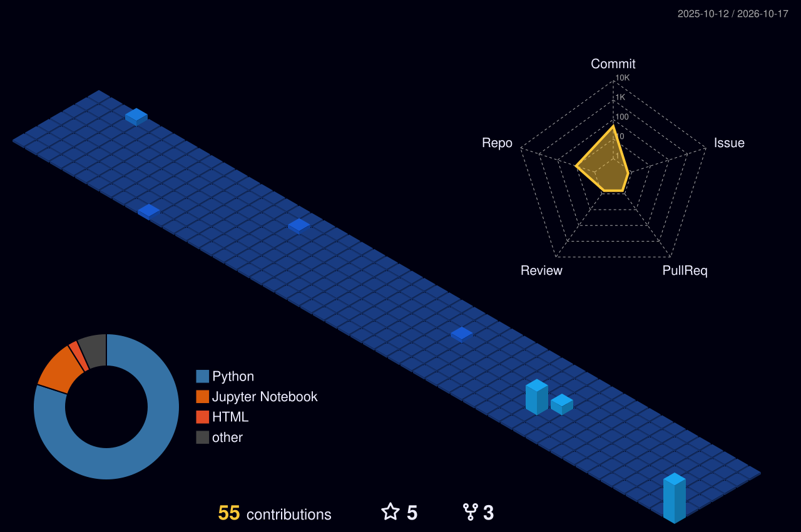

<!-- BADGE:START -->
  <picture>
    <source media="(prefers-color-scheme: dark)" srcset="https://raw.githubusercontent.com/ZayanShahid/ZayanShahid/main/id_badge_dark.svg?v=2ab58682">
    <source media="(prefers-color-scheme: light)" srcset="https://raw.githubusercontent.com/ZayanShahid/ZayanShahid/main/id_badge_light.svg?v=b94b668e">
    
  </picture>
<!-- BADGE:END -->
    

  
  
  

---

### 🚀 About Me

I enjoy exploring ambitious ideas, architecting scalable backend systems, and turning them into real production products.

- 🎓 Holds an **MS in Computing and Data Science**.
- 🔭 I’m currently working on **Multi-tiered Data Loss Prevention (DLP) pipelines, LLM agent orchestration, and automated n8n workflows.**
- 🌱 I’m constantly learning **Advanced Python Backend Architecture, AI Security & Red Teaming, and Self-Hosted Cloud Infrastructure.**
- 💼 Open for **Software Engineering, Python Backend & AI Engineering roles**

---

### 🛠️ Tech Stack

<!-- TECH:START -->

| **Languages & Core** | **AI & Security** | **Backend & Data** | **Tools & Cloud Lab** |
| :---: | :---: | :---: | :---: |
|   |  [-0078D4?style=flat&logo=microsoft&logoColor=white)](https://microsoft.github.io/presidio/)  |     |     |

<!-- TECH:END -->

---

### 📂 Top Projects

<!-- PROJECTS:START -->
| Project | Description | Tech Stack |
| :--- | :--- | :--- |
| **[Enterprise DLP & AI Security Suite](https://github.com/ZayanShahid)** | Multi-tiered Data Loss Prevention scanner integrating regex, Shannon entropy, context scoring, and Microsoft Presidio. | `Python` `MS Presidio` `Regex` `Promptfoo` |
| **[M365 Copilot Governance Suite](https://github.com/ZayanShahid)** | 7-pillar security & compliance assessment suite with automated Graph API auditing and dynamic DOCX reporting. | `Python` `Graph API` `Automation` |
| **[AI Content & Webhook Orchestrator](https://getsol.tech)** | Self-hosted multi-node automation workflows connecting LLMs, webhooks, and custom domain routing. | `n8n` `LangChain` `Gemini API` `Docker` |
| **[Personal Portfolio](https://shahidse.vercel.app)** | My personal portfolio showcasing backend engineering projects, skills, and architecture. | `Vercel` `Python` `REST APIs` |
| **[ZayanShahid](https://github.com/ZayanShahid/ZayanShahid)** | - | `Python` |
| **[test1-repo](https://github.com/ZayanShahid/test1-repo)** | - | - |
<!-- PROJECTS:END -->

---

### 💻 My Live Status Desk

  
<i>A dynamic, auto-updating SVG showing my current local time (PKT) and coding status.</i>

<!-- DESK:START -->

<!-- DESK:END -->

---

### 🏙️ My GitHub City

  

---

  
<i>Let's build something interesting!</i>

